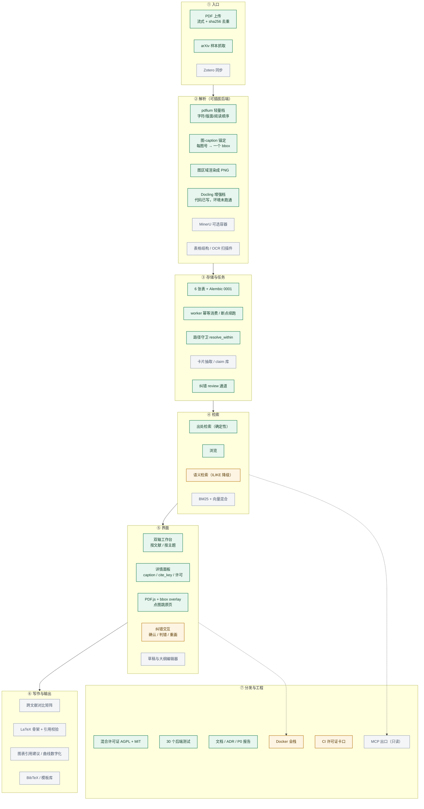

<!-- SPDX-License-Identifier: AGPL-3.0-or-later -->

# 项目结构与进度

> ⚠️ **历史快照（2026-11-12 前）**：现状以 `docs/09-现状交接.md` 为准（本文的状态表已过期）。

状态标记：**✅ 已实现并验证** · **🟡 有代码未验证 / 降级实现** · **⬜ 未开始**

## 结构图

## 按层清点

| 层 | ✅ 已完成 | 🟡 部分 | ⬜ 未做 |
| --- | --- | --- | --- |
| ① 入口 | PDF 上传（流式 + sha256 去重）、arXiv 样本 | — | Zotero 同步 |
| ② 解析 | pdfium 轻量档、图-caption 锚定（68%）、图渲染、多行 caption、**Docling 增强档（A/B 已跑）** | — | MinerU、表格抽取、OCR |
| ③ 存储 | 6 表 + 迁移 0001/0002、worker、路径守卫、**纠错通道** | — | 卡片/claim |
| ④ 检索 | 出处、浏览、按纠错状态过滤 | 语义（ILIKE） | BM25 + 向量 |
| ⑤ 界面 | 双轴、详情、bbox overlay、判定按钮 | 纠错交互（还不能拖拽重画框） | 草稿 |
| ⑥ 输出 | — | — | 全部 |
| ⑦ 工程 | 许可证、36 测试、文档 | Docker（compose 校验过但没真跑）、CI | MCP |

## 为什么是这个顺序

`②解析 → ③存储 → ④出处检索 → ⑤overlay` 先做完，是因为**这三层决定了产品是否可信**：
用户能不能按图号找到图、找到后能不能回到原文核实。写作侧（⑥）依赖前三层的证据质量，
在证据还不稳的时候做渲染层，等于给空气做 PPT。

## 下一步的优先序

1. **review 纠错通道**（③⑤）——用户与 agent 共用，纠正结果沉淀成 golden set。
   现在 overlay 让人能看见框错了，但还不能"说它错了"，这是当前最别扭的地方。
2. **Docling 在容器里跑通并做 A/B**（②）——决定默认解析档，也是把 69% 往上抬的正路。
3. **多行 caption 合并**（②③）——影响每张卡片可读性，改动小。
4. 之后才是 ⑥ 写作侧。
